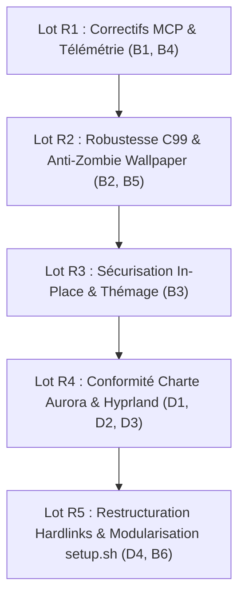

# Synthèse Exécutive de l'Audit & Matrice d'Améliorations — Aurora Hyprland

**Auteur** : Architecte (Équipe Zygos)  
**Projet** : Hyperland (`/home/user/Documents/antigravity/hyprland_project`)  
**Tâche** : T3 — Synthèse d'audit et matrice d'améliorations hiérarchisée (Jalon 1 ➔ Jalon 2)  
**Statut** : Validé  

---

## 1. Synthèse Exécutive de la Santé de l'Écosystème Aurora

L'audit consolidé du Jalon 1 (couvrant l'audit syntaxique/statique T1 et l'audit approfondi de code/architecture T2) dresse un bilan très positif sur la robustesse structurelle et la conception générale du bureau Aurora Hyprland :
- **Architecture graphique C99** : Le choix d'un micro-moteur natif Wayland layer-shell (`aurora-wallpaper`) reposant sur un FBO unique mutualisé (1920x1080) blitté sur les sorties Wayland minimise l'empreinte GPU et évite les instabilités des solutions vidéo lourdes.
- **Intégration FastMCP** : L'écosystème expose des outils de haut niveau complets permettant le diagnostic en direct, le pilotage multimédia (MPRIS Spotify), le centre de notifications (SwayNC) et la gestion de session.
- **Charte visuelle Aurora** : Les piliers du design system (rayon 17px, bordures néon 2px, translucidité 0.50, dégradé à 45°) sont respectés sur la majorité des composants (Hyprland, Wofi, Floating Card).
- **Discipline volumétrique** : **0 infraction absolue** sur la limite de 500 lignes pour le code du projet.

Néanmoins, **10 anomalies et axes d'amélioration** ont été identifiés, dont **1 anomalie bloquante** sur le serveur MCP, **2 anomalies majeures** de concurrence et d'écriture de fichiers, et **7 anomalies de conformité, robustesse ou modularité**.

---

## 2. Matrice Hiérarchisée des Anomalies

### 2.1 Tableau Synthétique de Priorisation

| Réf. | Criticité | Module impacté | Fichier cible | Résumé de l'anomalie |
| :--- | :--- | :--- | :--- | :--- |
| **B1** | **Bloquant** | Serveur MCP | `scripts/aurora_mcp/system_tools.py` | Incohérence clé dict (`all_ok` vs `ok`) : `reload_all()` renvoie toujours `ok: False`. |
| **B2** | **Majeur** | Moteur Wallpaper | `scripts/wallpaper_tool.py` | Fausse détection zombie : kill immédiat d'`aurora-wallpaper` pendant l'initialisation EGL. |
| **B3** | **Majeur** | Thémage Dynamique | `scripts/theme_switcher.py` | Troncature non-atomique (`open("w")`) et regex agressive écrasant la fin de `kitty.conf`. |
| **B4** | **Moyen** | Serveur MCP / Status | `scripts/aurora_mcp_server.py` | Faux positif d'état actif du démon Spotify Card par simple existence du lockfile `/tmp`. |
| **B5** | **Moyen** | Moteur C99 Wayland | `src/aurora_wallpaper/main.c` | Polling non-bloquant + `usleep(33ms)` aveugle aux événements Wayland ; omission `SIGPIPE`. |
| **B6** | **Alerte** | Déploiement / Volumétrie | `setup.sh` | Dépassement seuil alerte (428 lignes $\ge 400$) et copie directe hors paquet dans `/usr/bin/`. |
| **D1** | **Mineur** | Conformité Charte | `dotfiles/waybar/bar-bg.svg` | Rayon `rx=16` au lieu de 17px, et dégradé horizontal (0°/180°) au lieu de 45°. |
| **D2** | **Mineur** | Conformité Charte | `dotfiles/swaync/style.css` | Bordure popover contextuel à 1.5px au lieu des 2px stricts de la charte Aurora. |
| **D3** | **Mineur** | Paramétrage Ergonomie | `dotfiles/hypr/hyprland.conf` | `follow_mouse = 0` (focus au clic obligatoire, désactive le focus fluide au survol). |
| **D4** | **Mineur** | Intégrité Inodes | `~/.config/{hypr,waybar,kitty,wofi}` | Liens symboliques de répertoires au lieu de répertoires réels avec hard links individuels. |

---

### 2.2 Fiches Techniques Détaillées des Anomalies

#### [B1] Clé dictionnaire asymétrique dans `reload_all()` (Bloquant)
- **Localisation** : `scripts/aurora_mcp/system_tools.py` (lignes 63 et 230).
- **Mécanisme du bogue** : `_check_hardlinks_dict()` génère un dictionnaire avec la clé `"all_ok": bool`. La fonction `reload_all()` agrège les résultats via `all(r.get("ok", False) for r in results.values())`. Comme `results["hardlinks"]` ne possède pas la clé `"ok"`, `r.get("ok", False)` évalue systématiquement à `False`.
- **Impact** : Tout appel MCP à `reload_all` échoue logiquement, empêchant les automatisations de valider le rechargement.
- **Solution Programmeur** : Dans `_check_hardlinks_dict()`, standardiser la clé : `"ok": len(mismatches) == 0 and len(missing) == 0` (ou conserver `"all_ok"` et ajouter un alias `"ok"`).

#### [B2] Concurrence critique et faux positif zombie au démarrage EGL (Majeur)
- **Localisation** : `scripts/wallpaper_tool.py` (lignes 201–207).
- **Mécanisme du bogue** : Lors de `ensure_wallpapers()`, les PIDs actifs de `aurora-wallpaper` sont confrontés aux surfaces recensées par `hyprctl layers -j`. L'initialisation EGL et la compilation des shaders prenant entre 50 et 150 ms, le processus n'est pas encore enregistré dans le namespace de calque. Il est immédiatement classé comme "zombie" et abattu par `terminate_procs(zombies)`.
- **Impact** : En cas d'événements IPC rapprochés (ex: hotplug d'écran), le moteur de fond d'écran entre dans une boucle d'abattage et de relance perpétuelle.
- **Solution Programmeur** : Exclure de la purge les processus récents (âge < 500 ms via `/proc/<pid>/stat`) ou introduire un `time.sleep(0.25)` avant de statuer sur l'absence de calque Wayland.

#### [B3] Troncature non-atomique et expressions régulières destructives (Majeur)
- **Localisation** : `scripts/theme_switcher.py` (lignes 28–36 et 124–125).
- **Mécanisme du bogue** :
  1. `write_inplace()` utilise `open(path, "w")`, qui tronque immédiatement le fichier à 0 octet avant l'écriture. Une exception ou une rupture d'alimentation corrompt définitivement la configuration cible.
  2. `update_kitty_conf()` applique `re.sub(r"# Colors.*", colors_block, text, flags=re.DOTALL)`, remplaçant tout le contenu jusqu'à la fin du fichier et effaçant les configurations personnalisées post-palette.
- **Impact** : Perte de configuration utilisateur et risque d'invalidation syntaxique de Kitty et SwayNC.
- **Solution Programmeur** : Utiliser `open(path, "r+")` avec réécriture au début puis `truncate()`. Insérer des balises sentinelles explicites (`# AURORA_PALETTE_START` ... `# AURORA_PALETTE_END`) pour borner la substitution dans `kitty.conf` et `swaync/style.css`.

#### [B4] Détection fallacieuse du démon Spotify Floating Card (Moyen)
- **Localisation** : `scripts/aurora_mcp_server.py` (ligne 139).
- **Mécanisme du bogue** : `card_daemon_running = Path("/tmp/spotify_card.lock").exists()`. Le fichier verrou n'étant jamais supprimé lors de la mort d'un processus, le serveur MCP signale le démon comme actif alors qu'il est éteint.
- **Impact** : Télémétrie erronée renvoyée aux modèles et agents de supervision.
- **Solution Programmeur** : Vérifier la vivacité du processus par `fcntl.flock(fd, LOCK_EX | LOCK_NB)` ou `pgrep -f "spotify-card.py daemon"`.

#### [B5] Boucle d'événements aveugle et absence d'isolation `SIGPIPE` en C99 (Moyen)
- **Localisation** : `src/aurora_wallpaper/main.c` (lignes 254–256 et 344–366).
- **Mécanisme du bogue** :
  1. `poll(&pfd, 1, 0)` non-bloquant suivi de `usleep(frame_duration_us - elapsed_us)` (33,3 ms). Pendant le sommeil, le processus ne traite aucun événement Wayland.
  2. Absence de `signal(SIGPIPE, SIG_IGN)` : si le compositeur Hyprland redémarre ou ferme le socket, `wl_display_flush()` provoque la terminaison immédiate du processus par signal sans passer par les destructeurs EGL/GL.
- **Impact** : Latence de réaction aux reconfigurations d'écrans et terminaison abrupte sans journalisation.
- **Solution Programmeur** : Calculer le reliquat de trame en millisecondes et l'utiliser comme timeout de `poll(&pfd, 1, timeout_ms)`. Ajouter `signal(SIGPIPE, SIG_IGN)` dans `main()`.

#### [B6] Volumétrie et déploiement hors paquet dans `setup.sh` (Alerte)
- **Localisation** : `setup.sh` (428 lignes).
- **Mécanisme du bogue** : Dépasse le seuil d'alerte de 400 lignes. La fonction `deploy_tripartite` copie directement des exécutables dans `/usr/bin/` avec `sudo`, risquant d'écraser des paquets gérés par `apt`/`pacman`.
- **Solution Programmeur** : Scinder `setup.sh` en modules réutilisables (`scripts/setup/` : paquets, compilation, hardlinks) sous 250 lignes chacun. Restreindre l'installation par défaut à `~/.local/bin/`.

#### [D1 à D4] Écarts de conformité graphique et de liaison inodes (Mineur)
- **D1** (`dotfiles/waybar/bar-bg.svg`) : Remplacer `rx="16" ry="16"` par `rx="17" ry="17"`. Corriger le dégradé linéaire vectoriel en définissant un angle à 45° (`x1="0%" y1="0%" x2="100%" y2="100%"`).
- **D2** (`dotfiles/swaync/style.css`) : Aligner la bordure de `.swaync-context-popover` sur `2px solid @noti-border-color`.
- **D3** (`dotfiles/hypr/hyprland.conf`) : Rétablir `follow_mouse = 1` pour permettre la sélection fluide des fenêtres sans clic préalable obligatoire. *(Note Jalon 4 : Décision utilisateur contraire — maintien strict de `follow_mouse = 0` comme invariant).*
- **D4** (`~/.config/{hypr,waybar,kitty,wofi}`) : Remplacer les 4 liens symboliques de répertoires par de vrais répertoires physiques contenant des liens physiques (`ln`) fichier par fichier, afin de garantir l'intégrité de la charte hardlinks d'Aurora.

---

## 3. Plan d'Action & Découpage pour le Programmeur (Jalon 2)

Le Jalon 2 (Remédiations) est découpé en **5 lots de travaux indépendants et testables** :

### Lot R1 : Correctifs MCP & Télémétrie (`system_tools.py`, `aurora_mcp_server.py`)
- **Périmètre** : `scripts/aurora_mcp/system_tools.py`, `scripts/aurora_mcp_server.py`.
- **Objectifs** :
  1. Corriger le dictionnaire de `_check_hardlinks_dict()` pour renvoyer `"ok": len(mismatches) == 0 and len(missing) == 0`.
  2. Valider que `reload_all()` renvoie `"ok": True` lorsque le système est nominal.
  3. Remplacer le test d'existence de `/tmp/spotify_card.lock` par un test de processus actif (`pgrep` ou essai de verrou non-bloquant).
- **Test de validation** : `python3 scripts/aurora_mcp_server.py status` et `python3 scripts/aurora_mcp_server.py reload`.

### Lot R2 : Robustesse Moteur Natif C99 & Concurrence IPC (`main.c`, `wallpaper_tool.py`)
- **Périmètre** : `src/aurora_wallpaper/main.c`, `scripts/wallpaper_tool.py`.
- **Objectifs** :
  1. Dans `main.c`, supprimer `usleep(33ms)` et intégrer le délai résiduel de la trame dans `poll(&pfd, 1, timeout_ms)`.
  2. Ajouter `signal(SIGPIPE, SIG_IGN)` dans l'initialisation de `main.c`.
  3. Dans `wallpaper_tool.py` (`ensure_wallpapers`), ajouter un délai de grâce de 250 ms avant de purger un processus démarré n'ayant pas encore finalisé son calque Wayland.
- **Test de validation** : `make -C src/aurora_wallpaper` puis `wallpaper_tool.py restart && wallpaper_tool.py status`.

### Lot R3 : Sécurisation de l'Écriture In-Place & Regex (`theme_switcher.py`, `theme_templates.py`)
- **Périmètre** : `scripts/theme_switcher.py`, `scripts/theme_templates.py`.
- **Objectifs** :
  1. Réécrire `write_inplace()` en mode `"r+"` avec écriture au début et `truncate()`, ou validation du descripteur.
  2. Délimiter le bloc de couleurs dans `kitty.conf` et `swaync/style.css` par des balises sentinelles (`# AURORA_PALETTE_START` / `# AURORA_PALETTE_END`).
  3. Ajouter une validation regex des codes hexadécimaux dans `hex_to_rgb()` pour prévenir tout `ValueError`.
- **Test de validation** : Application successive des 4 thèmes via `theme_switcher.py apply <nom>` et vérification d'invariance des inodes.

### Lot R4 : Conformité Esthétique Charte Aurora & Paramétrage (`bar-bg.svg`, `swaync`, `hyprland.conf`)
- **Périmètre** : `dotfiles/waybar/bar-bg.svg`, `dotfiles/swaync/style.css`, `dotfiles/hypr/hyprland.conf`, `scripts/theme_templates.py`.
- **Objectifs** :
  1. Dans `bar-bg.svg` et `theme_templates.py`, ajuster `rx="17" ry="17"` et orienter le dégradé à 45° (`x1="0%" y1="0%" x2="100%" y2="100%"`).
  2. Dans `dotfiles/swaync/style.css`, fixer la bordure de `.swaync-context-popover` à 2px solid.
  3. Dans `dotfiles/hypr/hyprland.conf`, réactiver `follow_mouse = 1` *(Infirmé : invariant `follow_mouse = 0` confirmé par l'utilisateur)*.
- **Test de validation** : `python3 tests/test_audit_aurora_conformity.py` (doit atteindre 5/5 conformes).

### Lot R5 : Restructuration des Hardlinks & Modularisation de `setup.sh` (`setup.sh`)
- **Périmètre** : `setup.sh`, `~/.config/`.
- **Objectifs** :
  1. Déployer de vrais répertoires physiques dans `~/.config/hypr`, `kitty`, `waybar`, `wofi` contenant les liens physiques individuels (remplacement des symlinks de répertoires).
  2. Modulariser `setup.sh` en extrayant l'installation des dépendances et les compilations de patchs dans des sous-scripts sous `scripts/setup/` pour repasser `setup.sh` sous 250 lignes.
  3. Restreindre les cibles d'installation binaire à `$HOME/.local/bin` par défaut (suppression de l'altération forcée de `/usr/bin/`).
- **Test de validation** : `python3 tests/test_audit_hardlinks.py` (doit afficher 100% de True Hard Links individuels, 0 Directory Symlink).

---

## 4. Critères d'Acceptation Globaux du Jalon 2

1. **Exécution des tests d'audit** :
   - `python3 tests/test_audit_dotfiles_syntax.py` ➔ **PASS**
   - `python3 tests/test_audit_aurora_conformity.py` ➔ **PASS**
   - `python3 tests/test_audit_hardlinks.py` ➔ **100% True Hard Links (0 directory symlinks)**
2. **Exécution MCP** :
   - `python3 scripts/aurora_mcp_server.py reload` renvoie `"ok": True`.
   - `python3 scripts/aurora_mcp_server.py status` renvoie un état fidèle sans faux positif démon.
3. **Volumétrie** :
   - `wc -l setup.sh` $\le 250$ lignes.
   - Tous les fichiers du dépôt $\le 400$ lignes (respect strict plafond 500 l.).

---

## 5. Addendum de Remédiation & Invariants Définitivement Validés

1. **Invariant Utilisateur Inaltérable `follow_mouse = 0` (Décision D3)** :
   - Contrairement à la proposition préliminaire de l'audit initial d'activer `follow_mouse = 1`, l'utilisateur a expressément confirmé sa préférence pour le mode **Click-to-Focus** (`follow_mouse = 0`). Ce choix garantit l'étanchéité du focus lors du déplacement du curseur d'un écran à l'autre (`DP-2` et `DP-1`) et est scellé comme invariant de recette.
2. **Décompte Physique Nominal des Hard Links (42/42)** :
   - Le socle physique individuel compte exactement **42 hard links nominaux** reliant `dotfiles/` à `~/.config/`, sans aucun symlink de répertoire.
3. **Catalogue MCP & Diagnostic (13 Outils Réels)** :
   - Le serveur FastMCP Aurora consolide **13 outils réels** (toute référence au renderer obsolète ayant été éliminée).
4. **Politique de Veille & Verrouillage (Décision P1)** :
   - Suspension PC (`systemctl suspend` à 1800s) inhibée sous verrou via `systemd-inhibit --what=sleep` et garde dans `hypridle.conf`, tout en maintenant l'extinction des dalles à 330s (`hyprctl dispatch dpms off`).
5. **Dossier Runtime Sécurisé (`$AURORA_RUNTIME_DIR`)** :
   - Standardisé sur `${XDG_RUNTIME_DIR:-/run/user/$(id -u)}/aurora` (mode `0700`, verrous `0600`).
